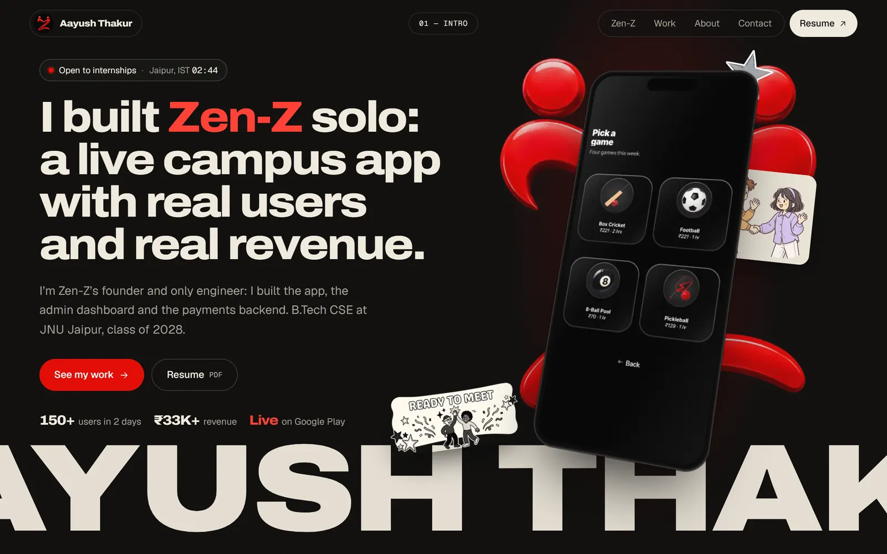
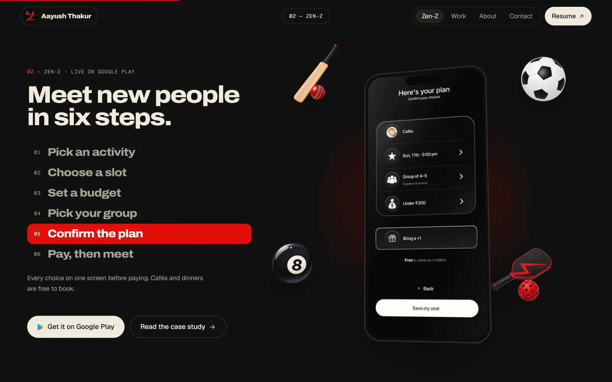
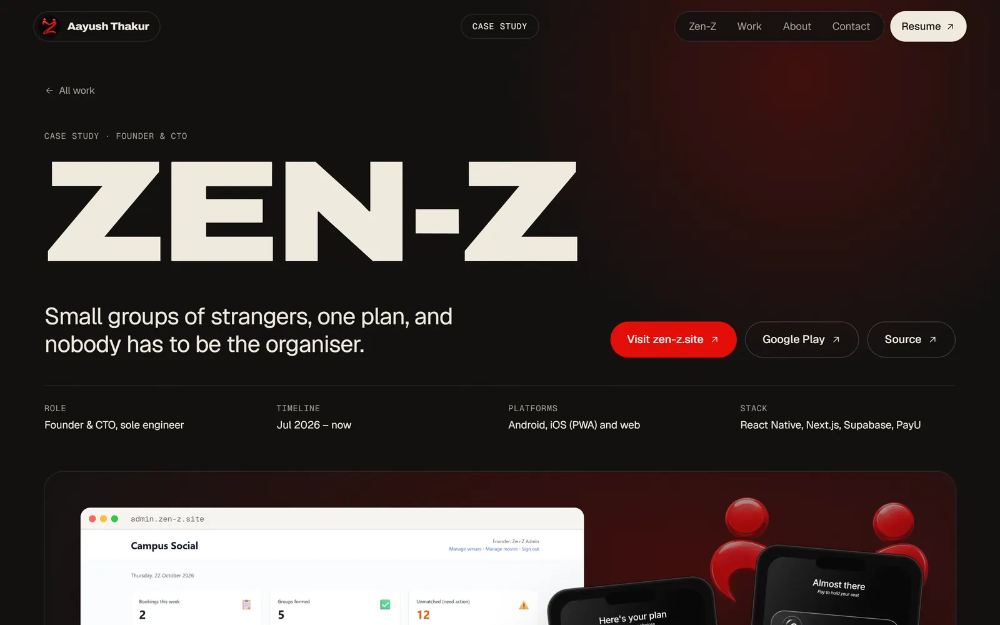
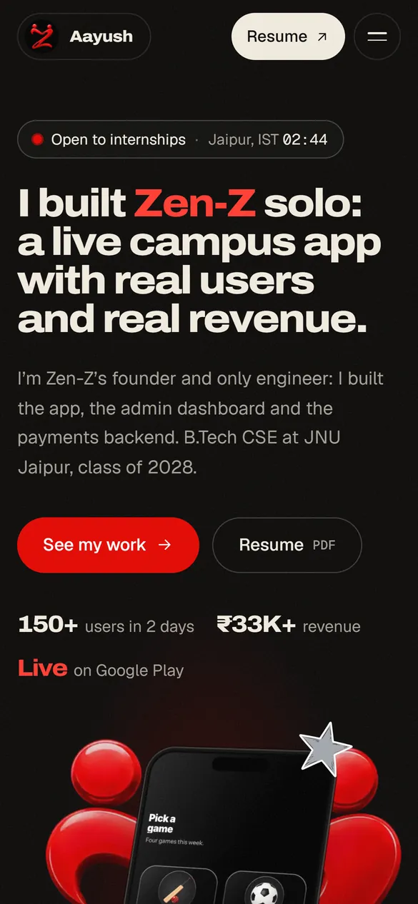

# Aayush Thakur: portfolio

**Live: [aayushthakur.vercel.app](https://aayushthakur.vercel.app)**

<a href="https://aayushthakur.vercel.app"></a>

The portfolio of Aayush Thakur, founder and solo engineer of [Zen-Z](https://zen-z.site), a campus
app live on Google Play. It's built like a launch page for that app: Zen-Z's red on black, cream
sections, and one CSS-3D phone running the real app that travels through the page.

<table>
  <tr>
    <td width="50%"><br><sub><b>The booking flow</b>: the phone pins while the six steps play</sub></td>
    <td width="50%"><br><sub><b>Case study</b>: <code>/work/zen-z</code></sub></td>
  </tr>
</table>

<p align="center"></p>

## What's interesting

- **A phone that travels.** One CSS-3D element (no three.js) starts tilted in the hero, flies into
  the Zen-Z section as you scroll, pins while the booking flow steps through its six screens, then
  settles flat. It's one GSAP ScrollTrigger timeline, re-measured on resize.
- **Smooth scroll that stays out of the way.** GSAP ScrollTrigger and Lenis share one ticker. With
  `prefers-reduced-motion` there's no Lenis, no pins or scrubs, marquees stop and the intro is
  skipped; everything is still there.
- **Fast on phones.** GSAP and Lenis are one lazy chunk loaded only at ≥768px with motion allowed,
  so phones never download them; their motion is CSS (scroll-driven fades, marquees, snap rows).
  All text is server-rendered and readable without JS, the hero entrance is CSS from first paint,
  and every route is static.
- **Lighthouse** (local production build): `/` 89–90 mobile and 97 desktop performance, other
  routes 93–99; 100 accessibility, best practices and SEO everywhere; CLS 0.
- **Facts in one file.** Every number, link and tool comes from [`src/lib/site.ts`](src/lib/site.ts),
  and `llms.txt`, the JSON-LD and the OG images are generated from it.

## Stack

Next.js 16 (App Router), React 19, TypeScript, Tailwind CSS v4, GSAP (ScrollTrigger, SplitText,
ScrambleText), Lenis. Archivo (variable width and weight) for display, Geist and Geist Mono for
text and labels, self-hosted and subset. Hosted on Vercel.

## Routes

| Route | What's there |
| --- | --- |
| `/` | Intro (once per session) → hero with the travelling phone and the name marquee → tech bands → the pinned Zen-Z booking flow → under the hood (architecture, payment loop, the same-day fix) → selected work → PrelimsDaily stacking cards → the orbiting stack → about → contact |
| `/work/zen-z` | Zen-Z case study: problem, what was built (pinned flow rail), the website, architecture, the payment fix, results |
| `/work/prelimsdaily` | PrelimsDaily case study: the one-day brief, decisions and trade-offs, tests |
| `/stack` | Every tool by layer, filterable by where it shipped (CSS only) |
| `/llms.txt` | A plain-text brief generated from `site.ts` |

Each route has its own title, description, canonical URL, Open Graph/Twitter image and JSON-LD.

## Run it

```bash
npm install
npm run dev        # http://localhost:3000
npm run build      # production build (every route prerendered)
npm run start      # serve the production build
npm run lint
```

## Deploy

Vercel, with Git integration: every push to `main` deploys. Set `NEXT_PUBLIC_SITE_URL` to the
production URL; it's the canonical origin for the sitemap, OG tags, JSON-LD and llms.txt (without
it, Vercel's production domain is used). Step-by-step notes are in [PLAN.md](PLAN.md).

<details>
<summary><b>Project structure and swappable media</b></summary>

```
src/
  app/                 layout (fonts, metadata, pre-paint script), template (page transition),
                       home, work/*, stack, OG/Twitter images, sitemap, robots, manifest, llms.txt
  sections/home/       hero, tech bands, Zen-Z showcase, under the hood, work index,
                       PrelimsDaily stack, stack orbit, about
  sections/zenz/       Zen-Z case + the payment fix
  sections/prelims/    PrelimsDaily case
  components/          site chrome, phone, case layout and media, architecture, icons
  motion/              the desktop chunk: global effects, home journey, case rails
  lib/                 site.ts (facts, links, stack), media.ts (video slot), jsonld, metadata, og-image
```

- **Portrait:** replace `src/assets/about/portrait.jpg` (4:5). The red duotone and halftone are CSS.
- **Zen-Z screen recording:** put `zenz-demo.mp4`, `zenz-demo.webm` and `zenz-demo-poster.jpg` in
  `public/media/`, then fill in `zenzDemo` in `src/lib/media.ts`. The hero phone switches from the
  screenshot loop to the video.

</details>

## Credits

Archivo by Omnibus-Type, Geist and Geist Mono by Vercel, all under the SIL Open Font License. Brand
glyphs from Simple Icons (CC0). Zen-Z art, icons and screenshots are from the Zen-Z app;
PrelimsDaily screenshots from [aayush-t-exe/prelims-daily](https://github.com/aayush-t-exe/prelims-daily).
